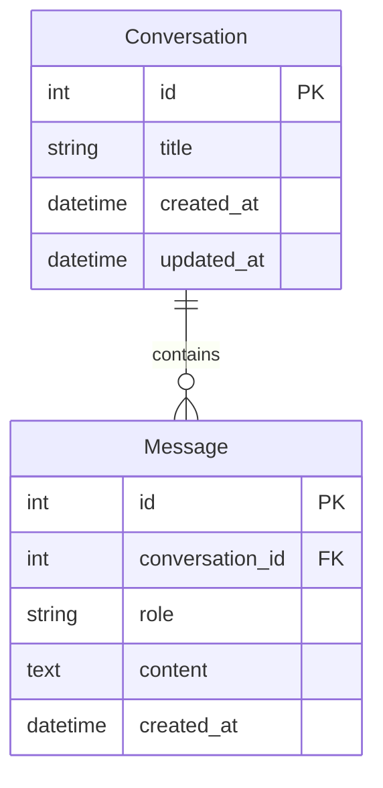

# Chatbot

Next.js と FastAPI で構築した、会話履歴を SQLite に保存する ChatBot Web アプリです。新規会話、会話切替、削除、履歴を含む OpenAI へのメッセージ送信に対応しています。

## 使用技術

- **Frontend:** Next.js, React, and TypeScript
- **Backend:** FastAPI, Python, and SQLAlchemy
- **Database:** SQLite
- **AI:** OpenAI API

補助ライブラリ: Pydantic / pydantic-settings（入力・環境設定）、Uvicorn（ASGIサーバー）、OpenAI Python SDK、pytest / HTTPX、ESLint、Playwright。

## システム構成

ブラウザー → Next.js の React UI（localhost:3000）→ FastAPI REST API（localhost:8000）→ SQLAlchemy → SQLite。
OpenAI API との通信はバックエンドのみが行い、APIキーをブラウザーへ渡しません。画面状態は React Hooks で管理し、選択中の会話IDだけを localStorage に保存します。本文は SQLite が正本です。

## ディレクトリ構成

```text
chatbot/
├── AGENTS.md
├── frontend/
│   ├── src/app/                 # App Router、レイアウト、CSS
│   ├── src/components/          # ChatApp / Sidebar / MessageList / Composer
│   ├── src/lib/api.ts           # 型定義とAPIクライアント
│   ├── tests/chat.spec.ts       # ブラウザー統合テスト
│   ├── playwright.config.ts
│   ├── package.json
│   ├── package-lock.json
│   └── .env.example
├── backend/
│   ├── app/
│   │   ├── main.py              # 起動エントリー
│   │   ├── api.py               # REST APIとアプリ生成
│   │   ├── models.py            # Conversation / Message
│   │   ├── schemas.py           # 入出力検証
│   │   ├── database.py          # SQLite接続と外部キー
│   │   ├── config.py            # 環境変数
│   │   └── ai.py                # OpenAI通信・エラー変換
│   ├── tests/                  # API / AI / 永続化 / E2E用サーバー
│   ├── pyproject.toml
│   └── .env.example
└── docs/                       # 検証と作業記録
```

## セットアップ（Windows PowerShell）

Node.js 22以上、npm、Python 3.12以上を用意してください。各コマンドはリポジトリのルートから実行します。インストールにはインターネット接続が必要です。

```powershell
cd C:\Users\aiue1\projects\chatbot
python -m venv backend/.venv
New-Item -ItemType Directory -Force backend/.tmp | Out-Null
$env:TEMP = "$PWD/backend/.tmp"
$env:TMP = $env:TEMP
backend/.venv/Scripts/python.exe -m pip install --cache-dir backend/.pip-cache -e "./backend[dev]"
Copy-Item backend/.env.example backend/.env
cd frontend
npm ci --cache .npm-cache
```

`backend/.env` の `OPENAI_API_KEY` に自分のキーを設定してください。既存 `.env` がある場合は上書きコピーせず編集します。キー未設定でも会話の作成・一覧・削除は動きますが、送信は503エラーを画面に表示します。

## 起動方法

バックエンド用ターミナル（ルートから）:

```powershell
backend/.venv/Scripts/python.exe -m uvicorn app.main:app --app-dir backend --host 127.0.0.1 --port 8000
```

フロントエンド用の別ターミナル:

```powershell
cd frontend
$env:NEXT_TELEMETRY_DISABLED = "1"
npm run dev -- --hostname 127.0.0.1
```

[画面を開く](http://localhost:3000) / [API仕様 Swagger UI](http://localhost:8000/docs) / [ヘルスチェック](http://localhost:8000/health)。本番ビルドをローカル確認する場合は `npm run build` の後に `npm run start -- --hostname 127.0.0.1` を使用します。

## 環境変数

| 変数 | 設定場所 | 既定値・用途 |
| --- | --- | --- |
| OPENAI_API_KEY | backend/.env またはプロセス環境 | 必須（AI送信時のみ）、値を公開しない |
| OPENAI_MODEL | backend/.env | gpt-4o-mini |
| DATABASE_URL | backend/.env | backend/chatbot.db の絶対SQLite URL |
| CORS_ORIGINS | backend/.env | localhost:3000、127.0.0.1:3000 のJSON配列 |
| NEXT_PUBLIC_API_URL | frontend/.env.local | http://localhost:8000 |

環境変数は `.env` より優先されます。設定変更後はサーバーを再起動してください。フロントエンドの公開変数はビルド時に埋め込まれるため再ビルドが必要です。`.env`、`.env.local`、DB、仮想環境、キャッシュは `.gitignore` 対象です。`.env.example` のみ管理します。

## REST API

| メソッド | パス | 用途 / 正常ステータス |
| --- | --- | --- |
| GET | /health | 稼働確認 / 200 |
| GET | /api/conversations | 更新日時の降順の会話一覧 / 200 |
| POST | /api/conversations | `{}` または `{ "title": "タイトル" }` で会話作成 / 201 |
| GET | /api/conversations/{id} | 会話とメッセージ一覧 / 200 |
| DELETE | /api/conversations/{id} | 会話と所属メッセージを削除 / 204 |
| POST | /api/conversations/{id}/messages | `{ "content": "質問" }` を送信し更新後の会話を返す / 201 |

存在しない会話は404、不正な入力は422、処理競合は409です。タイトルは1〜100文字、本文は空白のみ不可・最大10,000文字。最初の送信で既定タイトルを本文の先頭40文字に変更します。過去のユーザー文とAI回答を時系列で全件送信します。

AI応答は45秒でタイムアウトし、認証・キー未設定は503、利用制限は429、通信失敗・空回答は502、タイムアウトは504になります。AIのエラー詳細やキーをクライアントへ漏らしません。成功時だけユーザー文とAI回答を一つのトランザクションで保存し、失敗時は入力欄に文面を保持します。画面では送信中の操作を抑止します。

## DB設計

| テーブル | カラム |
| --- | --- |
| conversations | id: INTEGER PK、title: VARCHAR(100)、created_at: DATETIME、updated_at: DATETIME |
| messages | id: INTEGER PK、conversation_id: INTEGER FK/index、role: VARCHAR(20)、content: TEXT、created_at: DATETIME |

日時はUTCで生成。roleはuser/assistantのみ。1会話に複数メッセージが属し、会話削除時はメッセージも削除します。サーバー起動時にテーブルを作成し、既存データは保持します。



## テスト

バックエンド（ルートから）:

```powershell
New-Item -ItemType Directory -Force backend/.test-data | Out-Null
backend/.venv/Scripts/python.exe -m pytest backend/tests --basetemp=backend/.test-data/pytest -q
```

フロントエンド（frontend内）:

```powershell
$env:NEXT_TELEMETRY_DISABLED = "1"
npm run lint
npm run typecheck
npm run build
```

統合テストはGoogle Chromeを使用し、ポート3000/8000を自動で起動・停止します。通常のサーバーを停止してから実行してください。

```powershell
New-Item -ItemType Directory -Force ../backend/.tmp | Out-Null
$env:TEMP = (Resolve-Path ../backend/.tmp).Path
$env:TMP = $env:TEMP
npx playwright test
$env:E2E_MISSING_KEY = "1"
npx playwright test
Remove-Item Env:E2E_MISSING_KEY
```

E2Eは外部AIのみテスト応答に置き換え、実API・実SQLiteで検証します。テストDBは `backend/.test-data/browser.db` で通常の履歴には影響しません。キー未設定テストは実際のエラー処理を通します。

## 運用範囲

課題・ローカル利用向けで、認証なし・単一ユーザー・Uvicorn 1 workerを想定しています。外部公開しないでください。書き込みはプロセス内ロックで直列化します。ストリーミング、複数ユーザー、DBマイグレーションは対象外です。履歴がモデルの文脈長を超えた場合は送信エラーとなるため新しい会話を作成してください。

実装参考: [Next.js公式ドキュメント](https://nextjs.org/docs/app/getting-started/installation)、[OpenAI Python SDK](https://github.com/openai/openai-python)。
